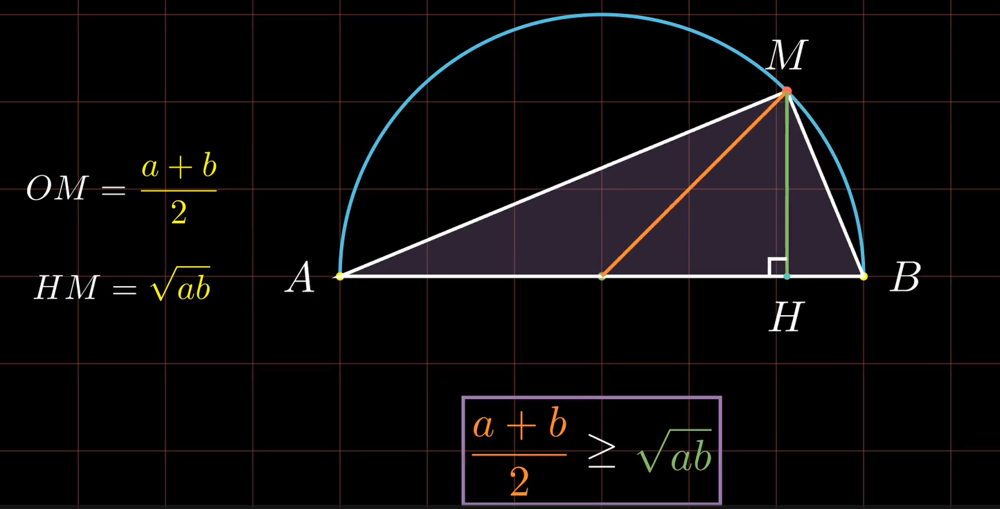

# The Solution Formula for Quartic Equations

  <a href="./x^4/No_x^4.py">Quartic Equations</a>

# Nicomachus's Theorem

[$\sum_{k=1}^{n} k^3$](./SumCubes.cpp)
# AM-GM Inequality

  <a href="./x^4/No_x^4.py">Quartic Equations</a>

